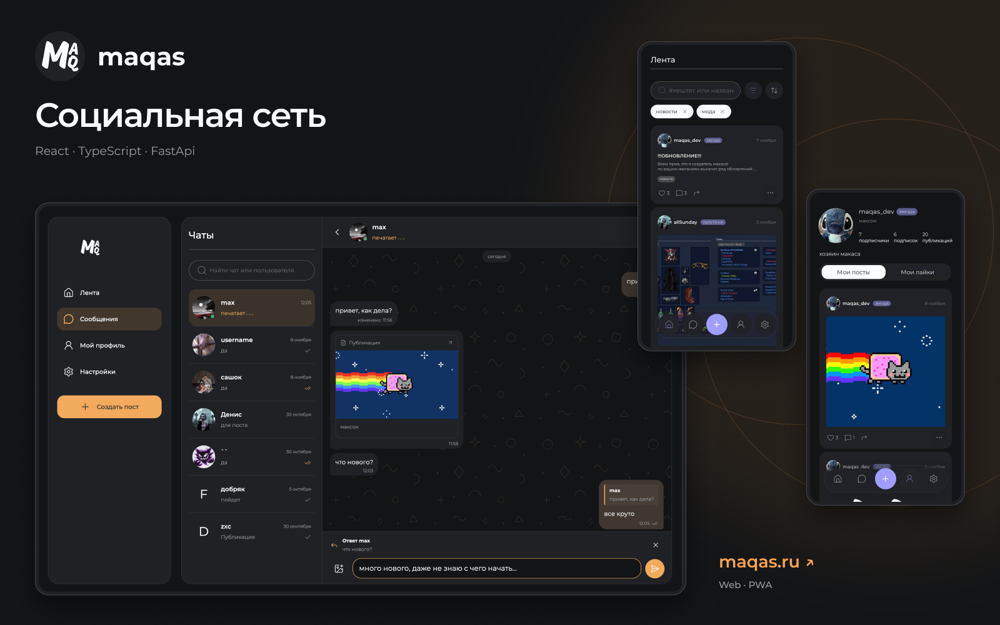
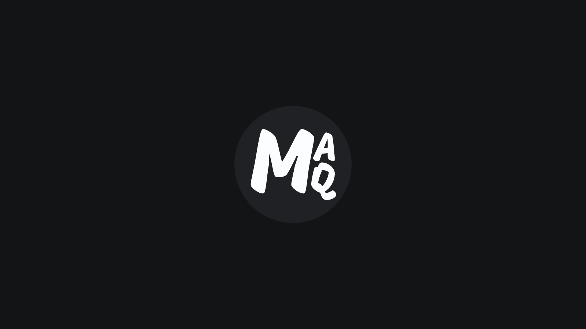

# Maqas

**Делитесь историями. Находите своих**

Maqas — социальная сеть с публикациями, обсуждениями и личными чатами. Приложение адаптировано для телефона и компьютера, поддерживает светлую и тёмную темы и установку как PWA

[Посмотреть демо](https://www.youtube.com/shorts/XRr-Y-O-swo)

## Возможности

- Публикации с текстом и фотографиями, теги, поиск и фильтры ленты
- Лайки, комментарии и ответы, редактирование и удаление своего контента
- Профили, подписки и чёрный список
- Личные чаты: сообщения и фотографии, пересылка постов в виде карточек
- Обновления чатов через WebSocket, статусы прочтения, онлайн и индикатор набора текста
- Бесконечная прокрутка, просмотр изображений и адаптивный интерфейс

## Видео

Демонстрация мобильной версии: публикации, комментарии и общение в чатах. Нажмите на превью, чтобы открыть видео на YouTube

## Документация

| Раздел | Что внутри |
| --- | --- |
| [Frontend](frontend/README.md) | Локальный запуск; подробная документация готовится |
| [Backend](backend/README.md) | Документация в разработке |
| [Деплой](deploy/README.md) | Docker Compose, окружение, HTTPS и обновление приложения |

## Технологии

| Часть | Стек |
| --- | --- |
| Frontend | React, TypeScript, Vite, Tailwind CSS, TanStack Query, Zustand |
| Backend | Python, FastAPI, SQLAlchemy, Alembic, WebSocket |
| База данных | PostgreSQL |
| Развёртывание | Docker Compose, nginx, HTTPS |

Для разработки клиентской части начните с [инструкции frontend](frontend/README.md), для запуска полного приложения — с [деплоя](deploy/README.md)
